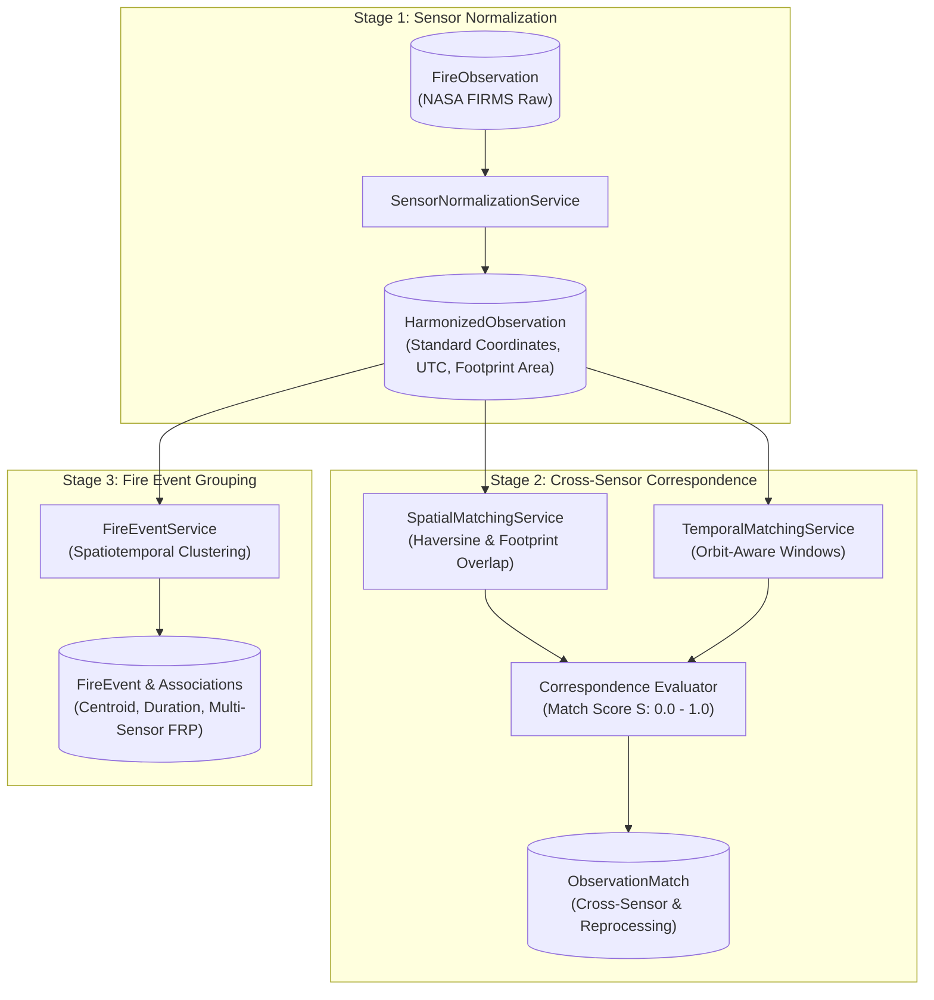

# FIRENEXUS – MODIS–VIIRS Hotspot Harmonization Methodology

**Module**: Harmonization Engine (`Phase 3`)  
**Algorithm Version**: `v1.0.0`  
**Scientific Domain**: Satellite Remote Sensing & Thermal Anomaly Observation Harmonization  

---

## 1. Executive Summary & Scientific Statement

Satellite observations of active fires from polar-orbiting radiometers provide critical insights into global biomass burning, wildfire behavior, and carbon emissions. However, the two preeminent operational spaceborne sensor systems—the **Moderate Resolution Imaging Spectroradiometer (MODIS)** on NASA's Terra and Aqua spacecraft, and the **Visible Infrared Imaging Radiometer Suite (VIIRS)** on Suomi-NPP, NOAA-20, and NOAA-21—feature fundamental differences in:

1. Spatial resolution and pixel footprint growth across the swath.
2. Radiometric dynamic range and saturation temperatures.
3. Minimum detectable Fire Radiative Power (FRP) sensitivity thresholds.
4. Confidence metrics calculation and meaning.
5. Equator crossing times and orbital mechanics.

The **FIRENEXUS Harmonization Engine** provides a transparent, scientifically responsible framework for identifying correspondences between MODIS and VIIRS thermal anomaly observations without erasing or fabricating measurements.

> [!CAUTION]
> **Scientific Integrity Notice**: Two thermal anomaly detections observed near each other are not automatically the same physical fire event. Spatial proximity and temporal alignment indicate algorithmic candidate correspondence, not guaranteed physical ground truth. Original raw NASA observations are **never overwritten or merged**.

---

## 2. Sensor and Platform Discrepancies Considered

| Characteristic | MODIS (Terra & Aqua) | VIIRS (Suomi-NPP, NOAA-20, NOAA-21) | Harmonization Implication |
|---|---|---|---|
| **Nadir Spatial Resolution** | 1.0 km in fire channels (B21/B22: 3.96 µm, B31: 11.03 µm) | 375 m in Imagery bands (I4: 3.74 µm, I5: 11.45 µm) | VIIRS pixel area at nadir is $\approx \frac{1}{7}\text{th}$ to $\frac{1}{9}\text{th}$ the area of a MODIS pixel. A single MODIS detection regularly contains multiple distinct VIIRS detections. |
| **Swath Width** | 2,330 km ($\pm 55^\circ$ scan angle) | 3,040 km ($\pm 56^\circ$ scan angle) | VIIRS provides full global daily coverage without inter-swath equatorial gaps typical of MODIS. |
| **Pixel Growth Across Swath** | Grows to ~2.0 km along-track $\times$ ~4.8 km along-scan at swath edge (~$10\times$ area expansion). | Onboard pixel aggregation constrains pixel growth to $\le 0.8\text{ km} \times 0.8\text{ km}$ at swath edge. | The effective search radius between pixel centroids must expand dynamically when matching off-nadir observations. |
| **Minimum Detectable FRP** | $\approx 8\text{--}10\text{ MW}$ (nadir under optimal conditions). | $\approx 0.5\text{--}1.0\text{ MW}$ (nadir under optimal conditions). | VIIRS detects small, cool, smoldering, or sub-canopy fires that are physically invisible to MODIS. The absence of a MODIS match does not indicate false detection. |
| **Saturation Temperature** | Band 21 saturates at $\approx 500\text{ K}$; Band 22 at $\approx 331\text{ K}$. | Band I4 saturates at $\approx 367\text{ K}$ (dual-gain helps, but high-intensity fires cause saturation). | Brightness temperatures between MODIS and VIIRS for intense flaming fires cannot be assumed linearly equivalent. |
| **Confidence Metric** | Continuous percentage score (0–100%) based on contextual tests and background variance. | Discrete 3-tier classification: `'low'`, `'nominal'`, `'high'`. | The two confidence schemes are fundamentally different. FIRENEXUS maps both to standard categories (`'low'`, `'nominal'`, `'high'`) while preserving the numeric score for MODIS. |
| **Equator Crossing Time (LST)** | Terra: 10:30 AM/PM; Aqua: 1:30 PM/AM. | Suomi-NPP / NOAA-20 / NOAA-21: 1:30 PM/AM. | Aqua and VIIRS overpasses over identical regions occur within 15–50 minutes of each other. Terra and VIIRS overpasses differ by ~3 hours, spanning the diurnal fire expansion cycle. |

---

## 3. Harmonization Pipeline Architecture

The harmonization pipeline executes in three decoupled, auditable stages:



---

## 4. Detailed Scientific Methodology

### 4.1 Stage 1: Sensor Normalization
- **Coordinate Precision**: Longitudes and latitudes are verified within WGS84 physical boundaries and represented in decimal degrees.
- **Timestamp Standardization**: All observation times are stored as timezone-aware UTC `TIMESTAMPTZ` datetimes.
- **Footprint Modeling**: Along-scan ($S$) and along-track ($T$) pixel footprints are preserved or estimated from scan angle models:
  $$\text{Area}_{\text{pixel}} = S \times T \quad (\text{km}^2)$$
- **Radiometric Mapping**: Primary 4 µm brightness temperatures, secondary 11 µm brightness temperatures, and Fire Radiative Power (MW) are preserved with original units.

### 4.2 Stage 2: Cross-Sensor Correspondence Matching

#### Spatial Geodesic Distance ($d$)
The great-circle center distance $d$ between observation $\text{obs}_1$ and $\text{obs}_2$ is calculated via the Haversine equation:
$$a = \sin^2\left(\frac{\Delta \phi}{2}\right) + \cos(\phi_1)\cos(\phi_2)\sin^2\left(\frac{\Delta \lambda}{2}\right)$$
$$c = 2 \cdot \text{atan2}\left(\sqrt{a}, \sqrt{1-a}\right)$$
$$d = R_{\text{Earth}} \cdot c \quad (R_{\text{Earth}} \approx 6,371,000\text{ m})$$

#### Footprint Intersection Ratio ($O_{\text{footprint}}$)
Effective circular footprint radii $r_1$ and $r_2$ are derived from each pixel's footprint area:
$$r = \frac{\sqrt{S \times T}}{2} \times 1000 \quad (\text{meters})$$
If $d \le |r_{\text{MODIS}} - r_{\text{VIIRS}}|$ and $r_{\text{MODIS}} > r_{\text{VIIRS}}$, the VIIRS observation is geometrically contained within the MODIS footprint ($O_{\text{footprint}} = 1.0$). If $d \ge r_1 + r_2$, the footprints do not intersect ($O_{\text{footprint}} = 0.0$).

#### Temporal Separation ($\Delta t$)
$$\Delta t = |t_{\text{MODIS}} - t_{\text{VIIRS}}| \quad (\text{seconds})$$
- **Same-Orbit Afternoon Pairs (Aqua $\leftrightarrow$ VIIRS)**: Default threshold $\Delta t_{\max} = 3,600\text{ s}$ (1 hour).
- **Cross-Orbit Diurnal Pairs (Terra $\leftrightarrow$ VIIRS)**: Default threshold $\Delta t_{\max} = 14,400\text{ s}$ (4 hours).

#### Correspondence Evidence Score ($S$)
An algorithmic match score $S \in [0.0, 1.0]$ is assigned to each candidate pair:
$$S_{\text{spatial}} = \max\left(0.0, 1.0 - \frac{d}{d_{\max}}\right)$$
$$S_{\text{temporal}} = \max\left(0.0, 1.0 - \frac{\Delta t}{\Delta t_{\max}}\right)$$
$$S = w_{\text{spatial}} \cdot S_{\text{spatial}} + w_{\text{temporal}} \cdot S_{\text{temporal}}$$
*(Default weights: $w_{\text{spatial}} = 0.60$, $w_{\text{temporal}} = 0.40$)*.

Candidates with $S \ge 0.70$ are designated `'confirmed'`, while $0.25 \le S < 0.70$ are designated `'candidate'`.

#### Multiple Matches Handling
Because of VIIRS's $375\text{ m}$ resolution versus MODIS's $1\text{ km}$ resolution, a single MODIS hotspot often corresponds to multiple adjacent VIIRS hotspots. The engine records every correspondence independently, preserving the 1-to-many relationship without forcing an artificial 1-to-1 merge.

---

### 4.3 Stage 3: Fire Event Grouping Layer

The event grouping layer clusters proximately and temporally aligned detections into higher-level `FireEvent` records using connected components:
- **Spatial Radius**: Observations within $R_{\text{event}} = 3,000\text{ m}$ (3.0 km) of each other.
- **Temporal Span**: Observations occurring within $\Delta T_{\text{event}} = 43,200\text{ s}$ (12 hours).
- **Cluster Aggregates Computed**:
  - Centroid coordinates $(\bar{\phi}, \bar{\lambda})$.
  - Active duration $T_{\text{active}} = \frac{t_{\text{last}} - t_{\text{first}}}{3600}\text{ hours}$.
  - Multi-sensor breakdown: `modis_count` and `viirs_count`.
  - Multi-sensor energy: `modis_frp_mw`, `viirs_frp_mw`, `total_frp_mw`, `max_frp_mw`, `avg_frp_mw`.

---

## 5. NRT and Standard Processing Handling

NASA FIRMS distributes both **Near Real-Time (NRT)** and **Standard Processing (SP)** products:
1. NRT products are generated within 3 hours using predictive orbital ephemeris.
2. SP products are science-quality reprocessings generated weeks or months later using definitive ephemeris and refined calibration.
3. When both exist for the same satellite pass, FIRENEXUS records their correspondence as `match_type = 'reprocessing_provenance'`.
4. NRT observations are **never deleted or overwritten** when SP data is ingested.

---

## 6. Configurable Parameters & Rationale

| Parameter | Default Value | Scientific Rationale |
|---|---|---|
| `max_spatial_distance_meters` | `2000.0` | Accommodates MODIS pixel centroid uncertainty and off-nadir pixel growth up to ~2 km along-track. |
| `use_footprint_geometry` | `True` | Accounts for off-nadir expansion where footprints overlap even if center distance exceeds nominal nadir resolution. |
| `default_max_time_diff_seconds` | `7200.0` (2h) | General default temporal window for satellite observation correspondence. |
| `same_orbit_max_time_diff_seconds` | `3600.0` (1h) | Strict temporal window for Aqua and VIIRS afternoon orbits (~15-50 min typical separation). |
| `diurnal_max_time_diff_seconds` | `14400.0` (4h) | Window spanning morning Terra (10:30) and afternoon VIIRS (13:30) diurnal fire cycle comparison. |
| `event_spatial_radius_meters` | `3000.0` (3km) | Regional fire complex radius grouping local flaming fronts without merging distant wildfires. |
| `event_temporal_window_seconds` | `43200.0` (12h) | Matches half-day diurnal burning cycles (active daytime vs overnight smoldering). |

---

## 7. How to Execute Harmonization

### Via Command-Line Interface (CLI):
```bash
# Set FLASK_APP
$env:FLASK_APP="backend\run.py"

# Display harmonization summary metrics
flask harmonize summary

# Execute harmonization run for a specific date
flask harmonize run --start 2026-05-01 --end 2026-05-01 --max-dist 2000 --max-time 7200
```

### Via Protected REST API:
```bash
curl -X POST http://localhost:5000/api/v1/harmonization/run \
  -H "Content-Type: application/json" \
  -H "X-Admin-Key: firenexus-admin-secret-dev-key" \
  -d '{"start_date": "2026-05-01", "end_date": "2026-05-01", "max_spatial_distance_meters": 2000}'
```

---

## 8. Automated Test Suite Execution

To execute the 67 unit and integration tests across the backend:

```bash
cd backend
.\.venv\Scripts\Activate.ps1
pytest -v tests
pytest --cov=app tests
```

---

## 9. Known Limitations

1. **Sub-Pixel Emissivity & Flaming Temperature**:
   - FRP measurements depend on sub-pixel fire temperature ($T_{\text{fire}}$) and fractional area ($p$). A single high-intensity small flame can emit identical FRP to a wide cooler smoldering fire.
2. **Cloud & Smoke Obscuration**:
   - Heavy pyrocumulonimbus smoke plumes attenuate 4 µm and 11 µm radiances differently between MODIS and VIIRS view angles.
3. **Terrain Orthorectification**:
   - Mountainous terrain causes parallax displacement between observations taken from differing satellite viewing zenith angles.
