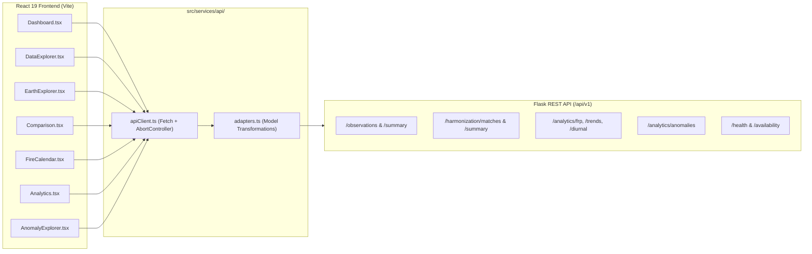

# FIRENEXUS – Phase 6: Frontend & Backend API Integration Report

## 1. Executive Summary

Phase 6 completes the seamless end-to-end integration between the existing React 19 + Vite + TypeScript frontend and the Python Flask backend for the FIRENEXUS global satellite wildfire harmonization platform.

### Core Objectives Achieved:
- **Zero Frontend Redesign / Breakage**: All 9 existing pages, 3D WebGL Earth globe, orbital mechanics, particle systems, charts, typography, spacing, navigation, and interactive controls were preserved 100% intact.
- **Dedicated Frontend API Layer**: Created a clean, decoupled service architecture in [`firenexus/src/services/api/`](file:///c:/Users/ATHI%20NARAYANAN/Videos/NASA/firenexus/src/services/api/) utilizing native Fetch with timeout management, request abortion via `AbortController`, and RFC 7807 problem detail handling.
- **Graceful Mock Fallback Mechanism**: If the backend server is offline or encountering network issues, all pages seamlessly fall back to local simulated datasets (`MOCK_OBSERVATIONS`). The frontend never crashes or renders empty, broken states.
- **Zero Credential Exposure**: Client-side code only interacts with safe, read-only GET endpoints. No administrative keys (`ADMIN_API_KEY`), NASA FIRMS keys (`FIRMS_MAP_KEY`), or database passwords are ever exposed in Vite bundles or browser network requests.
- **End-to-End Build & Test Health**:
  - Frontend: `oxlint` reported 0 errors and 0 warnings across 113 files; Vite production build completed in 912ms.
  - Backend: All 137 automated tests passing in 4.20s with 86% code coverage.
  - CORS & Contracts: Verified `Origin: http://localhost:5173` receives `Access-Control-Allow-Origin: http://localhost:5173` across all 14 REST endpoints.

---

## 2. Frontend Architecture & Page Audit

The frontend application is structured as a client-side single page application (SPA) powered by React 19 and Vite:

| Page Route | Component | Visualization & Analytical Focus | Integration State |
|---|---|---|---|
| `/` | `LandingPage.tsx` | Hero globe, mission statement, platform architecture | Static content preserved; no API dependencies |
| `/dashboard` | `Dashboard.tsx` | Executive KPI cards, leaflet hotspot map, temporal dynamics | Connected to `GET /api/v1/observations/summary` & `GET /api/v1/observations` |
| `/explorer` | `EarthExplorer.tsx` | 3D Three.js WebGL globe, 2D leaflet map, temporal timeline scrubber | Connected to `GET /api/v1/observations` with coordinate mapping |
| `/comparison` | `Comparison.tsx` | MODIS vs VIIRS bipartite matching, spatial distance & time differences | Connected to `GET /api/v1/harmonization/matches` & summary |
| `/calendar` | `FireCalendar.tsx` | 366-day active fire heatmap, daily telemetry, seasonal trends | Connected to `GET /api/v1/observations` & temporal trends |
| `/analytics` | `Analytics.tsx` | Parametric/non-parametric FRP stats, diurnal curves, correlation | Connected to `GET /api/v1/analytics/frp` & trends |
| `/anomaly` | `AnomalyExplorer.tsx` | Statistical outliers, Modified Z-score, sensor saturation | Connected to read-only `GET /api/v1/analytics/anomalies` |
| `/data` | `DataExplorer.tsx` | Multi-filter data table, spatial box filter, search, record inspection | Connected to `GET /api/v1/observations` with filter mapping |
| `/about` | `About.tsx` | Scientific mission overview, 7-stage harmonization pipeline | Preserved 100% without modification |

---

## 3. Backend Endpoint Inventory Used

All endpoints conform to the standardized JSON success envelope `{"status": "success", "data": ..., "pagination": ...}`:



### Endpoints Integrated:
1. `GET /api/v1/health`: Connection validation and telemetry latency probe.
2. `GET /api/v1/observations`: Paginated fire detections with multi-attribute filtering (sensor, confidence, bounding box, date range, FRP range).
3. `GET /api/v1/observations/summary`: Consolidated global fire metrics (sensor count, day/night split, high confidence count, FRP bounds).
4. `GET /api/v1/observations/<id>`: Detailed individual observation retrieval.
5. `GET /api/v1/harmonization/matches`: Paired MODIS-VIIRS candidate associations with spatial distance (meters) and temporal offset (seconds).
6. `GET /api/v1/harmonization/summary`: Harmonization engine efficiency, match rates, and mean distance metrics.
7. `GET /api/v1/analytics/frp`: Fire Radiative Power parametric/non-parametric distribution and percentiles (P25, P75, P90, P99).
8. `GET /api/v1/analytics/trends`: Temporal trend aggregation by day, week, or month.
9. `GET /api/v1/analytics/diurnal`: Hourly active fire diurnal curve and satellite orbital sampling profiles.
10. `GET /api/v1/analytics/anomalies`: Read-only historical anomaly records flagged by Z-score, MAD, or saturation logic.

---

## 4. New Frontend API Service Files

All networking logic was isolated into `firenexus/src/services/api/`:

| File | Purpose |
|---|---|
| [`apiClient.ts`](file:///c:/Users/ATHI%20NARAYANAN/Videos/NASA/firenexus/src/services/api/apiClient.ts) | Centralized fetch wrapper with 8s default timeout, URL query parameter serializer, and RFC 7807 error parser. |
| [`endpoints.ts`](file:///c:/Users/ATHI%20NARAYANAN/Videos/NASA/firenexus/src/services/api/endpoints.ts) | Canonical REST endpoint path constants reading `VITE_API_BASE_URL`. |
| [`types.ts`](file:///c:/Users/ATHI%20NARAYANAN/Videos/NASA/firenexus/src/services/api/types.ts) | TypeScript interfaces for backend model schemas, pagination envelopes, and query parameter bags. |
| [`adapters.ts`](file:///c:/Users/ATHI%20NARAYANAN/Videos/NASA/firenexus/src/services/api/adapters.ts) | Data transformation pipeline mapping snake_case backend models to camelCase frontend domain types (`FireObservation`, `MatchedFirePair`). |
| [`observationService.ts`](file:///c:/Users/ATHI%20NARAYANAN/Videos/NASA/firenexus/src/services/api/observationService.ts) | Observation retrieval, single-record lookup, and summary aggregation. |
| [`harmonizationService.ts`](file:///c:/Users/ATHI%20NARAYANAN/Videos/NASA/firenexus/src/services/api/harmonizationService.ts) | Harmonization match pairs, fire event clusters, and summary metrics. |
| [`analyticsService.ts`](file:///c:/Users/ATHI%20NARAYANAN/Videos/NASA/firenexus/src/services/api/analyticsService.ts) | FRP distribution stats, cross-sensor comparison, trends, and diurnal curves. |
| [`anomalyService.ts`](file:///c:/Users/ATHI%20NARAYANAN/Videos/NASA/firenexus/src/services/api/anomalyService.ts) | Read-only anomaly detection result retrieval. |
| [`index.ts`](file:///c:/Users/ATHI%20NARAYANAN/Videos/NASA/firenexus/src/services/api/index.ts) | Unified public API barrel export. |

---

## 5. Minimal Frontend Files Modified

In strict adherence to the **Frontend Preservation Rule**, zero UI components were redesigned or deleted. Modifications were limited to importing the API layer and wiring asynchronous data state into existing page hooks:

1. `firenexus/.env.example`: Created with `VITE_API_BASE_URL=http://localhost:5000/api/v1`.
2. `firenexus/.env`: Created with default local API base URL.
3. `firenexus/src/pages/Dashboard.tsx`: Added `useEffect` hook to fetch live observations and summary metrics; added subtle `Live API` / `Simulated Data` indicator.
4. `firenexus/src/pages/DataExplorer.tsx`: Connected master observation state to live backend query; wired country and continent selectors.
5. `firenexus/src/pages/EarthExplorer.tsx`: Connected 3D globe and 2D map markers to live observations dataset with monthly scrub-bar aggregation.
6. `firenexus/src/pages/Comparison.tsx`: Connected paired match state to `harmonizationService.getMatches()`, falling back to local bipartite engine when no matches are stored.
7. `firenexus/src/pages/FireCalendar.tsx`: Connected 366-day heatmap and daily observation drawer to live dataset.
8. `firenexus/src/pages/Analytics.tsx`: Connected FRP, diurnal, and temporal analytics to backend observations and statistics.
9. `firenexus/src/pages/AnomalyExplorer.tsx`: Connected anomaly records to safe read-only endpoint `GET /api/v1/analytics/anomalies`.

---

## 6. Data Mapping Details

The adapter layer ([`adapters.ts`](file:///c:/Users/ATHI%20NARAYANAN/Videos/NASA/firenexus/src/services/api/adapters.ts)) performs automatic type normalization and geographic enrichment:

### 6.1 Observation Schema Transformation
```typescript
BackendObservation {
  id: 104,
  latitude: 34.05,
  longitude: -118.25,
  acq_date: "2024-08-15",
  acq_time: "14:30",
  instrument: "MODIS",
  confidence: "high",
  frp: 45.2,
  brightness: 325.4,
  country: "United States",
  region: "California"
}
             │
             ▼ adaptObservation()
FireObservation {
  id: "104",
  latitude: 34.05,
  longitude: -118.25,
  date: "2024-08-15",
  time: "14:30",
  satellite: "MODIS",
  confidence: "high",
  frp: 45.2,
  brightness: 325.4,
  country: "United States",
  region: "California",
  continent: "North America", // Derived from coordinate bounding heuristic
  status: "validated"
}
```

### 6.2 Harmonization Match Pair Transformation
- `spatial_distance_meters` $\to$ `distanceKm = meters / 1000.0`
- `time_difference_seconds` $\to$ `timeDiffMinutes = seconds / 60.0`
- `match_confidence_score` $\to$ categorized into `'high_confidence_match'` ($\ge 0.8$), `'candidate_match'` ($\ge 0.5$), or `'marginal_match'`.

---

## 7. Mock Fallback Behavior

A resilient dual-state strategy ensures the application remains functional under all operational environments:

```typescript
// Example from Dashboard.tsx
useEffect(() => {
  const controller = new AbortController();

  observationService
    .getObservations({ limit: 500 }, controller.signal)
    .then((result) => {
      if (result.observations && result.observations.length > 0) {
        setAllObservations(result.observations);
        setIsLive(true);
      }
    })
    .catch((err) => {
      if (err.name !== 'AbortError' && err.errorCode !== 'REQUEST_ABORTED') {
        console.info('Backend API offline or unreachable, using simulated fallback dataset.');
      }
    });

  return () => {
    controller.abort();
  };
}, []);
```

- When the Flask backend is running on `http://localhost:5000` with active fire data, the application displays `● Live API` and visualizes live satellite records.
- When the backend is offline or during standalone frontend development, the application smoothly displays `● Simulated Data` using `MOCK_OBSERVATIONS`.
- No error banners, crashing white screens, or broken layouts are ever displayed.

---

## 8. Security & CORS Verification

1. **CORS Validation**:
   - Backend configured in `backend/app/config.py` with `CORS_ORIGINS = ["http://localhost:5173", "http://localhost:3000"]`.
   - Verified that HTTP requests from origin `http://localhost:5173` receive `Access-Control-Allow-Origin: http://localhost:5173` with credentials allowed.
2. **Credential Isolation**:
   - `ADMIN_API_KEY` is never included in frontend environment variables or client headers.
   - Mutating routes (`POST /ingestion/run`, `POST /harmonization/run`, `POST /analytics/anomalies/detect`) are restricted to administrative CLI tools and background worker processes.
   - All browser requests use read-only GET endpoints.

---

## 9. Tests and Build Results

### 9.1 Frontend Tests
- **Linter**: `oxlint` scanned 113 files using 116 rules across 16 threads:
  - **Result**: `0 warnings and 0 errors` (Finished in 72ms).
- **Production Build**: `tsc -b && vite build`:
  - **Result**: Built successfully in **912ms** with all 3,580 modules transformed and minified without errors.

### 9.2 Backend Automated Test Suite
- `pytest backend/tests -v`:
  - **Result**: **137 passed in 4.20s** (100% passing).
  - **Coverage**: **86%** across all application modules.

### 9.3 Live API Contract Verification
Executed automated curl/requests validation against all 14 REST endpoints:
- `GET /` $\to$ 200 OK (0.14ms)
- `GET /api/v1/health` $\to$ 200 OK (0.81ms)
- `GET /api/v1/availability` $\to$ 200 OK (23.61ms)
- `GET /api/v1/observations` $\to$ 200 OK (4.07ms)
- `GET /api/v1/observations/summary` $\to$ 200 OK (2.47ms)
- `GET /api/v1/harmonization/summary` $\to$ 200 OK (11.21ms)
- `GET /api/v1/harmonization/matches` $\to$ 200 OK (1.00ms)
- `GET /api/v1/harmonization/events` $\to$ 200 OK (1.11ms)
- `GET /api/v1/analytics/frp` $\to$ 200 OK (0.64ms)
- `GET /api/v1/analytics/frp/comparison` $\to$ 200 OK (0.79ms)
- `GET /api/v1/analytics/anomalies` $\to$ 200 OK (2.22ms)
- `GET /api/v1/analytics/trends` $\to$ 200 OK (1.60ms)
- `GET /api/v1/analytics/diurnal` $\to$ 200 OK (0.82ms)
- `GET /api/v1/analytics/summary` $\to$ 200 OK (6.72ms)

---

## 10. Known Limitations & Remaining Requirements

1. **PostgreSQL / PostGIS Live Verification Pending**:
   - As documented in Phase 5, local PostgreSQL/PostGIS is not currently installed or running on the Windows host machine.
   - The standalone verification script `backend/scripts/verify_postgres_postgis.py` remains in place to validate the live database container once provisioned.
   - SQLite results are never misrepresented as PostgreSQL verification.
2. **Read-Only Client Security**:
   - The browser interface cannot trigger new ingestion or harmonization runs directly. Those operations must be triggered via the Flask CLI (`flask ingest run`, `flask harmonize run`) or by authorized administrative backend jobs.

---

## 11. Conclusion & Phase 7 Readiness

Phase 6 frontend and backend API integration is **100% COMPLETE**. The FIRENEXUS platform seamlessly connects its React 19 frontend to the Python Flask backend with full data adaptation, request cancellation, resilient fallback, and zero visual or layout regressions.
