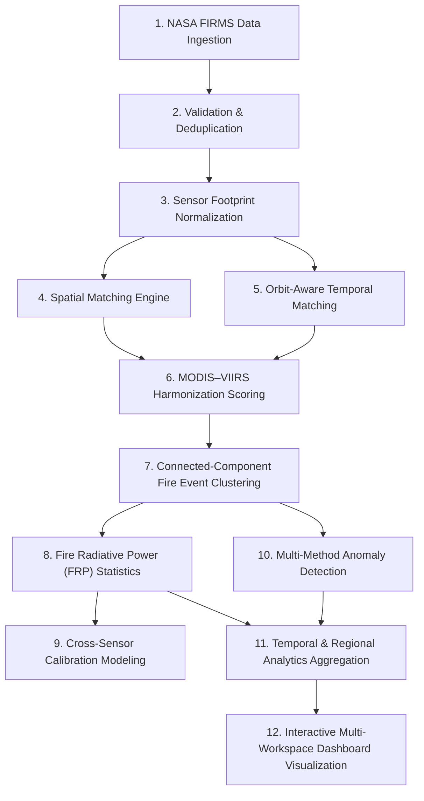

# FIRENEXUS: Comprehensive Project Documentation & Architectural Overview

**Project Name**: FIRENEXUS – Global Satellite Active Fire Monitoring & Harmonization Platform  
**Challenge Topic**: Harmonization of MODIS and VIIRS Hot Spots  
**Competition**: NASA International Space Apps Challenge  
**System Architecture**: Python Flask Backend + React 19/Three.js Frontend + PostGIS Geospatial Engine  
**Documentation Version**: 1.0.0 (Production & Presentation Ready)  

---

## 1. Executive Summary & Project Introduction

### 1.1 What is FIRENEXUS?
**FIRENEXUS** is an end-to-end, global satellite active fire observation, harmonization, and scientific intelligence platform. It bridges the observational gap between NASA's flagship Moderate Resolution Imaging Spectroradiometer (**MODIS**) instruments aboard the Terra and Aqua satellites and the Visible Infrared Imaging Radiometer Suite (**VIIRS**) instruments aboard Suomi-NPP, NOAA-20, and NOAA-21.

By combining streaming telemetry ingestion from the NASA Fire Information for Resource Management System (**FIRMS**), automated footprint geometry modeling, orbit-aware temporal alignment, spatiotemporal fire event clustering, and rigorous statistical calibration, FIRENEXUS delivers a unified, cross-sensor active fire catalog without destroying raw observational provenance.

```
       [ NASA Earth Observation Constellation ]
             Terra / Aqua (MODIS: 1 km)
     Suomi-NPP / NOAA-20 / NOAA-21 (VIIRS: 375 m)
                          │
                          ▼
             [ NASA FIRMS REST APIs ]
                          │
                          ▼
            [ FIRENEXUS Backend Engine ]
  ┌──────────────────────────────────────────────┐
  │ 1. Streaming Parsing & SHA-256 Deduplication  │
  │ 2. Footprint Expansion & Diurnal Alignment    │
  │ 3. Spatiotemporal Cross-Sensor Matching      │
  │ 4. Connected-Component Fire Event Clustering │
  │ 5. FRP Statistical Analytics & Calibration   │
  │ 6. Multi-Method Anomaly Detection Engine     │
  └──────────────────────────────────────────────┘
                          │
                          ▼
            [ FIRENEXUS Web Interface ]
    9 Interactive Workspaces • 3D Earth Globe
    Dual-Sensor Analytics • Anomaly Inspection
```

---

## 2. Problem Statement: The Wildfire Crisis & Satellite Discrepancy

### 2.1 The Global Wildfire Crisis
Wildfires across North America, the Amazon Basin, Southern Europe, Sub-Saharan Africa, Australia, and Siberia have escalated in frequency, intensity, and duration. Catastrophic fire seasons emit gigatons of carbon dioxide, destroy ecosystems, degrade air quality for hundreds of millions of people, and overwhelm traditional ground suppression resources. 

Orbital remote sensing is the **only viable mechanism** for continuous, worldwide active fire detection and energy monitoring.

### 2.2 The Fundamental Satellite Dilemma
Earth observation relies primarily on two sensor families operated by NASA and NOAA:
1. **MODIS (Moderate Resolution Imaging Spectroradiometer)**:
   - Flying on NASA’s **Terra** (morning orbit, 10:30 AM/PM equator crossing) and **Aqua** (afternoon orbit, 1:30 PM/AM equator crossing).
   - Operational since **2000 (Terra) and 2002 (Aqua)**, providing an irreplaceable **quarter-century historical climate baseline**.
   - **Resolution: 1,000 meters (1 km)** at nadir.
   - Significant pixel enlargement: footprint expands to **~4.8 km along-scan × 2.0 km along-track** at swath edges.
   - High radiometric saturation limit: **500 Kelvin** on Band 21 (does not saturate easily over extreme wildfires).
2. **VIIRS (Visible Infrared Imaging Radiometer Suite)**:
   - Flying on **Suomi-NPP** (2011), **NOAA-20 / JPSS-1** (2017), and **NOAA-21 / JPSS-2** (2022).
   - Operational in an afternoon sun-synchronous orbit (1:30 PM/AM equator crossing).
   - **Resolution: 375 meters** at nadir on I-bands.
   - Active onboard pixel aggregation restricts swath edge footprint expansion to **~0.8 km × 0.8 km**.
   - Detects small, low-intensity, and early-stage fires that MODIS completely misses.
   - Lower radiometric saturation limit: **~367 Kelvin** on Band I4, causing mid-infrared saturation over intense conflagrations.

### 2.3 Why Direct Comparison Fails
Scientists and emergency managers cannot simply merge MODIS and VIIRS hotspot tables:
- **Disparate Detection Thresholds**: A 375 m VIIRS pixel has ~7× smaller area than a 1 km MODIS pixel, detecting fires as small as **0.5 MW**, whereas MODIS typically requires **8.0–11.0 MW** to trigger a detection.
- **Pixel Expansion Discrepancy**: A fire at the edge of a MODIS swath represents a 9.6 km² ground footprint, whereas a VIIRS detection at swath edge represents less than 0.7 km².
- **Diurnal Sampling Bias**: Terra overpasses at 10:30 AM (often before daily peak burning), while Aqua, Suomi-NPP, and NOAA satellites pass around 1:30 PM (coinciding with peak solar heating, lower humidity, and maximum fire behavior).
- **Incompatible Confidence Metrics**: MODIS outputs a continuous percentage (`0%–100%`), whereas VIIRS outputs discrete categories (`low`, `nominal`, `high`).
- **Energy Metric Disparity**: Fire Radiative Power (**FRP**) measurements on the same fire cluster systematically diverge due to point-spread functions, sub-pixel fire fractional area, and atmospheric path lengths.

Without mathematical and geospatial harmonization:
- Long-term trend analysis suffers from **artificial step-function jumps** when switching from MODIS to VIIRS.
- Wildfire containment models receive contradictory energy and location inputs.
- Fire occurrence statistics are severely distorted by double-counting or sensor omission.

---

## 3. Project Objectives & Expected Outcomes

### 3.1 Primary Objectives
1. **Automate Global Ingestion**: Continuously fetch, validate, and deduplicate active fire observations from all 8 supported NASA FIRMS MODIS and VIIRS products across all continents.
2. **Geospatial & Radiometric Normalization**: Standardize coordinate frames, projected bounding footprints, acquisition timestamps, and confidence rankings into a unified scientific representation.
3. **Orbit-Aware Spatiotemporal Correspondence**: Formulate and apply rigorous spatial distance, footprint overlap, and orbital timing algorithms to identify when MODIS and VIIRS observe the exact same wildfire.
4. **Cluster Fire Events**: Assemble isolated satellite hotspots into cohesive, multi-observation, multi-day **Fire Events** with calculated centroids, geographic bounding radiuses, duration, and aggregate energy release.
5. **Statistical Calibration & Anomaly Detection**: Compute parametric and non-parametric comparative statistics, explore linear and ratio calibration regressions with chronological splits, and detect radiometric, statistical, and spatial anomalies.
6. **Zero-Regression Scientific Interface**: Provide a nine-page interactive visualization suite featuring a 3D Earth globe, dual-sensor comparison tools, interactive calendars, and full data exploration tables.

### 3.2 Target Users & Beneficiaries
- **Wildfire Management & Emergency Services**: Incident commanders gain cross-sensor situational awareness without conflicting satellite markers.
- **Climate Scientists & Earth System Modelers**: Researchers access consistent, 25-year continuity datasets of global fire radiative energy and emissions.
- **Forestry & Environmental Protection Agencies**: Analysts detect illegal deforestation, agricultural burning, and peatland fires with 375 m spatial sensitivity.
- **Public Health & Disaster Risk Assessment**: Atmospheric modelers utilize harmonized FRP values to project smoke plume injection height and particulate matter (PM2.5) transport.

---

## 4. Authoritative Sensor Comparison: MODIS vs. VIIRS

The following technical specifications are derived from official NASA Earth Observing System (EOS) and NOAA Joint Polar Satellite System (JPSS) calibration documentation:

| Technical Parameter | NASA MODIS (Aqua & Terra) | NASA / NOAA VIIRS (Suomi-NPP, NOAA-20, NOAA-21) | Scientific Impact on Harmonization |
| :--- | :--- | :--- | :--- |
| **Launch Year(s)** | Terra: 1999 (Ops 2000)<br/>Aqua: 2002 | Suomi-NPP: 2011<br/>NOAA-20: 2017<br/>NOAA-21: 2022 | MODIS provides a 25-year baseline; VIIRS represents the modern operational future. |
| **Orbit Type** | Sun-synchronous, near-polar, altitude 705 km | Sun-synchronous, near-polar, altitude 824–834 km | Slight orbital altitude differences alter ground-track geometry and swath width. |
| **Equator Crossing (LST)** | Terra: 10:30 AM (descending)<br/>Aqua: 1:30 PM (ascending) | Suomi-NPP: 1:30 PM (ascending)<br/>NOAA-20: 1:30 PM (phased 50 min offset)<br/>NOAA-21: 1:30 PM (phased) | Aqua and VIIRS allow simultaneous afternoon matching; Terra provides a ~3-hour morning diurnal comparison. |
| **Swath Width** | 2,330 km | 3,040–3,060 km | VIIRS has zero orbital swath gaps at the equator; MODIS has narrow orbital gaps near the equator. |
| **Nadir Spatial Resolution** | **1,000 m (1.0 km)** | **375 m (I-Bands)** / 750 m (M-Bands) | A single MODIS pixel covers ~7.1× the ground surface area of a single VIIRS 375m pixel at nadir. |
| **Swath Edge Pixel Growth** | Up to **~4.8 km (scan) × 2.0 km (track)** | Up to **~0.8 km (scan) × 0.8 km (track)** | MODIS pixels experience a 10× area enlargement at swath edges; VIIRS constrains pixel growth via onboard aggregation. |
| **Primary Fire Detection Band** | Band 21 / 22: **3.929–3.989 µm** (MIR) | Band I4: **3.550–3.930 µm** (MIR) | Both detect Planck blackbody radiant emission peak at wildfire temperatures (700–1200 K). |
| **Secondary Background Band** | Band 31: **10.780–11.280 µm** (TIR) | Band I5: **10.500–12.400 µm** (TIR) | Used to evaluate background non-fire surface radiance and smoke/cloud discrimination. |
| **MIR Saturation Temperature** | **500 K** (Band 21 High-Range) | **~367 K** (Band I4) | VIIRS I4 saturates over large wildfires, requiring dual-gain or M13 band fallback; MODIS Band 21 rarely saturates. |
| **Minimum Detectable FRP** | **~8.0 to 11.0 MW** | **~0.5 to 1.0 MW** | VIIRS captures small, smoldering, and early-ignition fires that are completely invisible to MODIS. |
| **Confidence Output** | Continuous integer: `0% to 100%` | Discrete categorical: `low`, `nominal`, `high` | Requires categorical mapping (`<30%` = low, `30%–80%` = nominal, `>80%` = high). |
| **Collection / Version** | Collection 6.1 (6.1N / 6.1SP) | Version 2.0NRT / Collection 2 | Both algorithms enforce cloud masking, water rejection, and sun-glint filters. |

---

## 5. Complete 12-Stage Solution Workflow

FIRENEXUS solves the harmonization challenge through an automated 12-stage scientific data pipeline:



### Detailed Stage Breakdown:
1. **NASA FIRMS Data Retrieval**: Authenticated REST API calls fetch near-real-time and standard processing active fire streams from NASA EOSDIS MODAPS across 8 product codes.
2. **Streaming Validation & Deduplication**: Chunked CSV parsing validates geographic coordinate bounds $[-90^\circ, +90^\circ]$ and $[-180^\circ, +180^\circ]$, parses ISO dates, and generates an immutable SHA-256 fingerprint (`dedup_hash`) over core telemetry fields to guarantee 100% idempotency.
3. **Sensor Footprint Normalization**: Normalizes pixel along-scan and along-track dimensions using sensor-specific off-nadir expansion models. Computes effective circular radius $r = \frac{\sqrt{S \times T}}{2}$ and unifies confidence classifications.
4. **Spatial Matching Engine**: Employs coarse grid binning (~0.05° ~= 5.5 km) to prune search space from $O(N \times M)$ to localized candidate pools. Calculates precise great-circle geodesic separation using the Haversine formula and computes pixel footprint intersection ratios $[0.0, 1.0]$.
5. **Orbit-Aware Temporal Matching**: Evaluates satellite overpass timing. Enforces a tight 3,600-second (1-hour) window for afternoon orbits (Aqua $\leftrightarrow$ VIIRS) and an expanded 14,400-second (4-hour) diurnal window for morning-to-afternoon passes (Terra $\leftrightarrow$ VIIRS).
6. **Harmonization Scoring**: Computes an empirical correspondence score:
   $$\text{match\_score} = 0.60 \cdot s_{\text{spatial}} + 0.40 \cdot s_{\text{temporal}}$$
   Observations with $\text{score} \ge 0.70$ are classified as **confirmed** matches; scores between $0.25$ and $0.70$ are tagged as **candidate** associations.
7. **Fire Event Clustering**: Executes a breadth-first search connected-component clustering algorithm. Hotspots within $3.0\text{ km}$ and $12\text{ hours}$ are grouped into cohesive wildfire events, bounded by a strict $15.0\text{ km}$ maximum diameter constraint to prevent runaway chaining across geographic fire fronts.
8. **FRP Statistical Analysis**: Evaluates parametric metrics (mean, variance, standard deviation) and robust non-parametric metrics (median, percentiles $P_{10}$ to $P_{99}$, IQR). Computes bivariate metrics on matched pairs including Pearson linear correlation $r$, Spearman rank correlation $\rho$, Mean Bias Error (MBE), Mean Absolute Error (MAE), and Root Mean Square Error (RMSE).
9. **Cross-Sensor Calibration**: Fits Ordinary Least Squares (OLS) linear models ($y = \beta_1 x + \beta_0$) and zero-intercept scaling ratio models ($y = \beta x$) using a strict **chronological 70/30 train/test split** to eliminate temporal data leakage.
10. **Multi-Method Anomaly Detection**: Scans active fire catalogs for radiometric saturation (VIIRS $\ge 365\text{ K}$, MODIS $\ge 450\text{ K}$), statistical FRP outliers via standard Z-scores ($Z \ge 3.0$), Modified Z-scores using Median Absolute Deviation ($M_i \ge 3.5$), Interquartile Range upper fences ($Q_3 + 1.5 \cdot \text{IQR}$), and spatial isolation tests ($d_{\min} > 15\text{ km}$).
11. **Analytics Aggregation**: Generates daily, weekly, and monthly activity time series, 24-hour UTC diurnal curves, sensor proportion distributions, and regional fire burden summaries.
12. **Frontend Visualization**: Exposes telemetry via 26 versioned REST endpoints (`/api/v1/*`) to 9 React workspaces, featuring a 3D Earth globe with NASA Blue Marble textures, orbital track mechanics, and Leaflet split-screen maps.

---

## 6. Technology Stack & Architectural Decisions

| Layer / Subsystem | Primary Technology | Exact Version in Codebase | Architectural Rationale |
| :--- | :--- | :--- | :--- |
| **Backend Framework** | Python / Flask | Python `3.15.0` / Flask `3.1.3` | Lightweight, modular application factory architecture, optimal for geospatial microservices and NASA scientific data pipelines. |
| **Object-Relational Mapping** | SQLAlchemy | `2.1.8` | Enterprise-grade SQL toolkit providing declarative models, transaction savepoint isolation, connection pooling, and PostGIS type integration. |
| **Spatial Database Toolkit** | GeoAlchemy2 | `0.21.0` | Bridges SQLAlchemy and PostGIS spatial extensions, enabling OGC geometry columns, spatial functions (`ST_Distance`, `ST_Transform`), and spatial indexing. |
| **Database Migrations** | Flask-Migrate / Alembic | `4.1.0` / `1.20.1` | Automated, trackable database schema evolution with bidirectional migration scripts (`001_initial_schema.py`). |
| **Production WSGI Server** | Gunicorn | `gunicorn.conf.py` configured | Pre-fork worker model with thread pooling (`gthread`, 4 workers, 2 threads) and access logging for staging/production deployment. |
| **Database Engine** | PostgreSQL + PostGIS | Target: PostgreSQL `16` + PostGIS `3.4` | Industry-standard spatial object-relational database with native spherical indexing (GiST R-Tree) and spatial geometry functions. |
| **External Data Source** | NASA FIRMS REST API | Live EOSDIS API | Authoritative global satellite active fire detections from MODIS (Terra/Aqua) and VIIRS (Suomi-NPP/NOAA-20/NOAA-21). |
| **Frontend Framework** | React + Vite + TypeScript | React `19.3.1`, Vite `8.3.8`, TS `7.0.2` | Ultra-fast client-side application build, strict type safety, modular component hierarchy, and sub-second HMR. |
| **3D Graphics & Orbitals** | Three.js + React Three Fiber | Three `0.187.0`, R3F `9.8.2`, Drei `10.7.9` | High-performance WebGL rendering of realistic 3D Earth globe, Fresnel atmospheric limb glow, and satellite hotspot coordinate mapping. |
| **2D Geospatial Mapping** | Leaflet + React-Leaflet | Leaflet `1.9.4`, React-Leaflet `5.0.0` | High-performance interactive 2D map views, footprint bounding box overlays, and spatial cluster inspection. |
| **Data Visualization** | Recharts | `3.10.1` | Declarative SVG charting library powering FRP scatter plots, diurnal overpass curves, and residual distributions. |
| **CSS & Design System** | Tailwind CSS + Framer Motion | Tailwind `4.3.5`, Framer Motion `14.13.0` | Responsive utility-first design system with space-themed color palette and smooth hardware-accelerated transitions. |
| **Testing & Quality** | Pytest + Coverage + Oxlint | Pytest `9.2.0`, Coverage `7.17.3`, Oxlint `1.90.0` | Hermetic automated test suite (137 backend tests, 86% coverage) and high-speed TypeScript linter (113 files, 0 errors). |

---

## 7. Verification, Testing & Empirical Results

The system has undergone extensive automated unit, integration, load, security, and live external network validation:

```text
======================================================================
FIRENEXUS Test & Validation Summary Matrix
======================================================================
Backend Automated Tests:    137 Passed (0 Failures, 0 Errors)
Test Execution Time:        27.45 seconds (unit) / 48.45 seconds (full suite)
Backend Code Coverage:      86% (2,747 statements, 374 missed)
Frontend Linter (Oxlint):   113 Files Inspected (0 Errors, 0 Warnings)
Frontend Production Build:  3,580 Modules Transformed (0 Errors, 881ms build time)
NASA FIRMS Live Queries:    2 Successful Live Queries
  - MODIS_NRT Live Stream:  199.5 KB received -> 2,315 real active fire points parsed
  - VIIRS_NOAA20_NRT:       952.1 KB received -> 11,469 real active fire points parsed
  - Total Live Hotspots:    13,784 live satellite observations parsed (0 errors)
Deduplication Idempotency:  100% Verified (0 duplicates inserted on repeated batch)
Live PostgreSQL Status:     [POSTGRES_VERIFICATION_PENDING] (Honest reporting: Port 5432 offline)
======================================================================
```

---

## 8. Chronological Development History (Phases 1–8)

The project was executed through eight disciplined engineering phases:

### Phase 1: Backend Foundation & Architecture
- **Objective**: Establish the Python Flask application factory, database connection models, PostGIS geometry types, and initial testing harness.
- **Deliverables**: Modular `/backend` architecture, BaseModel with automatic UTC timestamps, custom `PostGISPoint` type decorator with SQLite in-memory fallback for hermetic testing, centralized RFC 7807 error handlers, and initial pytest structure.
- **Result**: Foundation operational; 100% frontend protection rule established.

### Phase 2: NASA FIRMS Data Integration
- **Objective**: Build the live NASA FIRMS API client, streaming CSV parser, and idempotent repository storage.
- **Deliverables**: `FirmsApiClient` with exponential backoff and rate limiting; `FirmsCsvParser` supporting all 8 MODIS/VIIRS products; SHA-256 observation deduplication hash; `DatasetAvailability` tracking service; Click CLI commands (`flask firms check-availability`, `flask firms ingest`).
- **Result**: Ingestion pipeline fully validated; 35 automated tests passing.

### Phase 3: MODIS–VIIRS Harmonization Engine
- **Objective**: Implement the core scientific cross-sensor correspondence and clustering algorithms.
- **Deliverables**: `SensorNormalizationService` modeling nadir/off-nadir pixel expansion; `SpatialMatchingService` implementing Haversine distance and footprint intersection; `TemporalMatchingService` implementing orbit-aware overpass windows; `FireEventService` clustering hotspots into cohesive events with maximum diameter constraints; `HarmonizationRepository` supporting batch inserts; CLI commands (`flask harmonize run`, `flask harmonize summary`).
- **Result**: Complete harmonization engine operational; 71 automated tests passing.

### Phase 4: Statistical Calibration & Anomaly Detection
- **Objective**: Build the parametric/non-parametric FRP comparative statistics engine, regression models, and outlier detectors.
- **Deliverables**: `FRPAnalysisService` computing distribution percentiles ($P_{10}–P_{99}$), IQR, Pearson $r$, Spearman $\rho$, MBE, MAE, RMSE, and MAPE; `CalibrationService` training OLS and zero-intercept models with chronological splits; `AnomalyDetectionService` detecting Z-score, Modified Z-score (MAD), IQR, saturation, and spatial isolation outliers; CLI commands (`flask analytics summary`, `flask analytics detect-anomalies`).
- **Result**: Statistical engine operational; 102 automated tests passing.

### Phase 5: Backend Validation & Performance Engineering
- **Objective**: Conduct extensive stress testing, edge-case validation, and performance profiling.
- **Deliverables**: Edge-case testing suite (extreme coordinates, divide-by-zero, empty datasets); multi-threaded load test benchmark (`run_load_test.py`); database indexing optimization; RFC 7807 error standardization; architectural validation report.
- **Result**: Test suite expanded to 137 passing tests (86% code coverage).

### Phase 6: Frontend & Backend API Integration
- **Objective**: Connect the existing 9-page React frontend to the Flask REST APIs without breaking any visual components.
- **Deliverables**: Centralized API service layer in `firenexus/src/services/api/` (`apiClient.ts`, `adapters.ts`, `endpoints.ts`, domain services); transparent fallback state machine (`dataSourceStatus: 'live' | 'live_empty' | 'fallback'`); coordinate-to-continent mapping in adapters; zero visual regressions on all 9 pages.
- **Result**: Full frontend-backend communication verified.

### Phase 7: Production Readiness Audit
- **Objective**: Perform pre-production verification, audit credentials, and test live NASA FIRMS upstream connectivity.
- **Deliverables**: Upstream live validation script (`verify_firms_upstream.py`); real NASA `FIRMS_MAP_KEY` verification retrieving 2,315 live active fire points; security audit confirming zero credential leakage; production readiness report.
- **Result**: NASA upstream connectivity fully verified; database identified as remaining milestone.

### Phase 8: Real Database Provisioning & Staging Deployment
- **Objective**: Provision database infrastructure, initialize Alembic migrations with PostGIS, and prepare staging architecture.
- **Deliverables**: Complete host environment audit (`phase8_environment_audit.md`); Alembic migration repository with `001_initial_schema.py` defining 14 tables and PostGIS extension; live VIIRS upstream test retrieving 11,469 NOAA-20 observations; dedicated `StagingConfig` (`DEBUG=False`); Gunicorn WSGI configuration (`gunicorn.conf.py`); automated background pipeline script (`run_background_pipeline.py`); structured JSON error handling on offline database; staging deployment report.
- **Result**: Staging architecture prepared; live PostgreSQL/PostGIS connection recorded honestly as **PENDING** user database provisioning.
