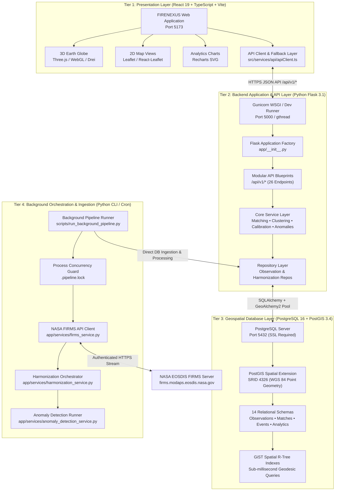
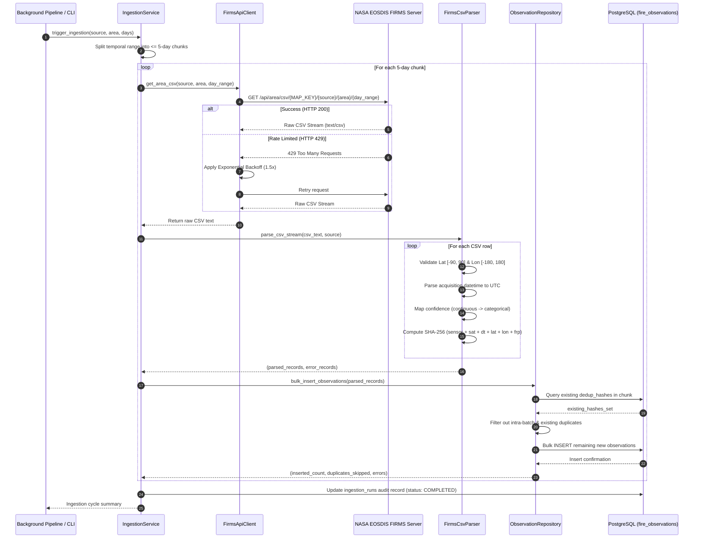
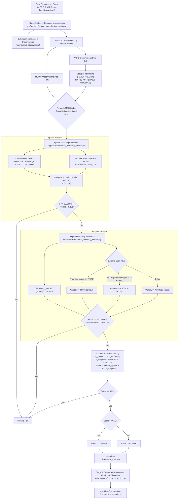
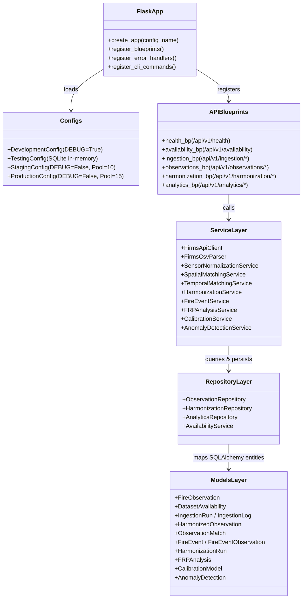
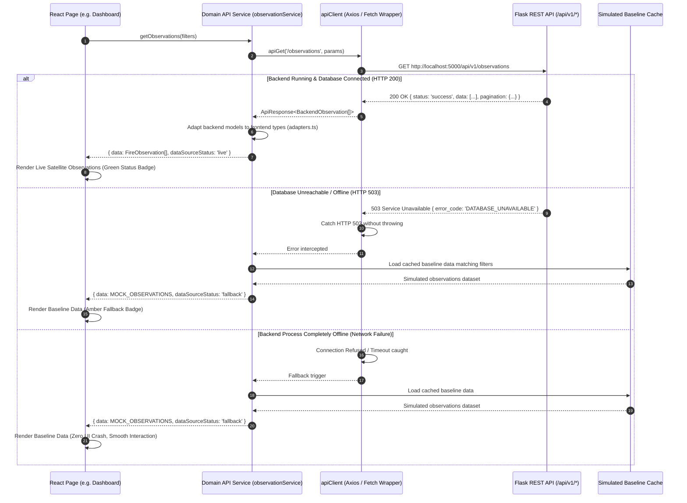

# FIRENEXUS: System Architecture & Technical Diagrams

**System**: FIRENEXUS Satellite Active Fire Monitoring & Harmonization Platform  
**Purpose**: Official Technical Diagrams for NASA Space Apps Presentation & Architecture Review  
**Diagram Format**: GitHub-Flavored Markdown Mermaid (`mermaid`)  

---

## 1. Overall System Architecture (Four-Tier Overview)

The FIRENEXUS architecture decouples presentation, application services, geospatial storage, and background processing into four distinct tiers.

---

## 2. NASA FIRMS Data Ingestion Pipeline

This diagram shows how NASA FIRMS CSV telemetry is requested, chunked, rate-limited, parsed in a memory-efficient stream, validated, deduplicated, and stored.

---

## 3. MODIS–VIIRS Harmonization & Matching Pipeline

This diagram details the core scientific harmonization engine, showing coarse grid binning, spatial Haversine distance, footprint overlap evaluation, temporal windowing, composite match scoring, and status assignment.

---

## 4. Backend Layered Architecture

This diagram illustrates the software structure of the Flask backend, detailing the separation of concerns across application factory, routes, services, repositories, and models.

---

## 5. Database Entity-Relationship Diagram (14 Relational Schemas)

This ERD diagrams all 14 database models, showing primary keys, foreign keys, spatial geometry columns, and relational associations.

```mermaid
erDiagram
    FIRE_OBSERVATIONS ||--o{ HARMONIZED_OBSERVATIONS : "normalizes to"
    FIRE_OBSERVATIONS ||--o{ OBSERVATION_MATCHES : "matched as MODIS"
    FIRE_OBSERVATIONS ||--o{ OBSERVATION_MATCHES : "matched as VIIRS"
    FIRE_OBSERVATIONS ||--o{ FIRE_EVENT_OBSERVATIONS : "grouped into"
    FIRE_EVENTS ||--o{ FIRE_EVENT_OBSERVATIONS : "contains"
    INGESTION_RUNS ||--o{ INGESTION_LOGS : "records"
    HARMONIZATION_RUNS ||--o{ OBSERVATION_MATCHES : "provenance"

    FIRE_OBSERVATIONS {
        string id PK "UUID"
        string dedup_hash UK "SHA-256 fingerprint"
        string source_product "e.g. MODIS_NRT, VIIRS_SNPP_NRT"
        string sensor "MODIS | VIIRS"
        string satellite "Terra, Aqua, Suomi-NPP, NOAA-20/21"
        string product_type "NRT | SP"
        date acq_date "Acquisition date"
        string acq_time "UTC HHMM"
        datetime acq_datetime "Timezone-aware UTC"
        float latitude "WGS 84 (-90 to +90)"
        float longitude "WGS 84 (-180 to +180)"
        geometry location "PostGIS Point SRID 4326"
        float brightness "Brightness temp 4um (K)"
        float bright_secondary "Brightness temp 11um (K)"
        float frp "Fire Radiative Power (MW)"
        string confidence "low | nominal | high"
        string day_night "D | N"
        float scan "Along-scan pixel dimension (km)"
        float track "Along-track pixel dimension (km)"
        datetime created_at
    }

    DATASET_AVAILABILITY {
        string id PK "UUID"
        string data_id UK "Product code"
        date min_date "Earliest available date"
        date max_date "Latest available date"
        string sensor "MODIS | VIIRS"
        string status "active | legacy | deprecated"
        datetime last_checked_at
    }

    INGESTION_RUNS {
        string id PK "UUID"
        string source_product "Product code"
        string status "running | completed | failed"
        datetime start_date
        datetime end_date
        int records_fetched
        int records_inserted
        int duplicates_skipped
        float duration_seconds
    }

    INGESTION_LOGS {
        string id PK "UUID"
        string run_id FK "References ingestion_runs.id"
        string level "INFO | WARNING | ERROR"
        string message "Audit text"
        datetime created_at
    }

    HARMONIZED_OBSERVATIONS {
        string id PK "UUID"
        string observation_id FK "References fire_observations.id"
        string sensor "MODIS | VIIRS"
        float footprint_along_scan_km
        float footprint_along_track_km
        float footprint_area_km2
        float frp_mw
        string confidence_category "low | nominal | high"
        string algorithm_version "v1.0.0"
        datetime normalized_at
    }

    OBSERVATION_MATCHES {
        string id PK "UUID"
        string modis_obs_id FK "References fire_observations.id"
        string viirs_obs_id FK "References fire_observations.id"
        string match_type "cross_sensor | reprocessing_provenance"
        float spatial_distance_meters
        float footprint_overlap_ratio
        float time_difference_seconds
        float match_score "0.000 to 1.000"
        string status "confirmed | candidate"
        datetime created_at
    }

    FIRE_EVENTS {
        string id PK "UUID"
        string event_code UK "e.g. EVT-20261114-A1F2"
        string status "active | inactive"
        datetime first_observed_at
        datetime last_observed_at
        float duration_hours
        float centroid_latitude
        float centroid_longitude
        geometry centroid_geom "PostGIS Point SRID 4326"
        float spatial_radius_meters
        int observation_count
        int modis_count
        int viirs_count
        float total_frp_mw
        float max_frp_mw
        float avg_frp_mw
    }

    FIRE_EVENT_OBSERVATIONS {
        string id PK "UUID"
        string event_id FK "References fire_events.id"
        string observation_id FK "References fire_observations.id"
        float distance_to_centroid_meters
        float time_offset_seconds
        datetime created_at
    }

    HARMONIZATION_RUNS {
        string id PK "UUID"
        string algorithm_version
        string status "running | completed | failed"
        int total_observations_analyzed
        int harmonized_records_created
        int matches_created
        int events_created
        float duration_seconds
    }

    FRP_ANALYSES {
        string id PK "UUID"
        string analysis_type "univariate | paired_comparison"
        string sensor "MODIS | VIIRS | ALL"
        int sample_size
        float mean_frp_mw
        float median_frp_mw
        float std_frp_mw
        float iqr_frp_mw
        float pearson_r
        float spearman_rho
        float mean_bias_error_mw
        float rmse_mw
    }

    CALIBRATION_MODELS {
        string id PK "UUID"
        string model_name UK
        string model_type "linear_ols | zero_intercept"
        float slope
        float intercept
        float r_squared
        float rmse
        float mae
        int train_count
        int test_count
        string status "active | deprecated"
    }

    ANOMALY_DETECTIONS {
        string id PK "UUID"
        string observation_id FK "References fire_observations.id"
        string anomaly_type "high_frp | high_brightness | spatial_isolation"
        string method "z_score | modified_z_score | iqr | saturation_threshold"
        float anomaly_score
        float threshold_applied
        string metric_name
        float metric_value
        string explanation
    }

    FIRE_ACTIVITY_SUMMARIES {
        string id PK "UUID"
        string aggregation_period "daily | weekly | monthly"
        date period_start
        date period_end
        int total_observations
        int modis_count
        int viirs_count
        float total_frp_mw
    }

    ANALYSIS_RUNS {
        string id PK "UUID"
        string run_type "frp_stats | calibration | anomaly_detection"
        string status "running | completed | failed"
        float duration_seconds
        datetime created_at
    }
```

---

## 6. Frontend–Backend Communication & Resilience Lifecycle

This diagram demonstrates how the React frontend interacts with the Flask backend, showing how network failures or database offline states are trapped by `apiClient.ts` to provide uninterrupted user navigation using simulated baseline fallbacks.

---

## 7. End-to-End Data Processing Lifecycle

This diagram illustrates the lifecycle of a single wildfire detection from initial orbital photon detection down to user interaction on the 3D Earth Globe.

```mermaid
flowchart LR
    subgraph Space["1. Spacecraft Thermal Detection"]
        Fire["Wildfire Flaming & Smoldering<br/>Radiant Heat: 800–1200 K"] --> MIR["Mid-Infrared Radiance<br/>MODIS 3.95µm / VIIRS 3.74µm"]
        MIR --> Optic["Satellite Optics & Detectors<br/>Instantaneous Field of View"]
    end

    subgraph Ground["2. Ground Station & NASA FIRMS"]
        Optic --> Downlink["X-Band Ground Downlink<br/>Direct Broadcast & Stored Playback"]
        Downlink --> MODAPS["NASA EOSDIS MODAPS<br/>Collection 6.1 / VIIRS v2 Algorithms"]
        MODAPS --> FIRMSFeed["NASA FIRMS REST API Endpoint<br/>Active Fire CSV Stream"]
    end

    subgraph Engine["3. FIRENEXUS Backend Engine"]
        FIRMSFeed --> Ingest["Streaming Ingestion & Parsing<br/>SHA-256 Deduplication"]
        Ingest --> PersistRaw["Store Raw Record<br/>(fire_observations)"]
        PersistRaw --> HarmEngine["Harmonization Engine<br/>Haversine + Footprint Overlap + Orbit Window"]
        HarmEngine --> EventClust["Connected-Component Clustering<br/>3 km Radius / 12 hr Window / 15 km Max Diam"]
        EventClust --> StatsCalib["FRP Statistics & Calibration<br/>OLS Regression & Anomaly Detection"]
    end

    subgraph UI["4. User Visualization & Exploration"]
        StatsCalib --> JSONAPI["Versioned JSON API<br/>/api/v1/observations & /harmonization/*"]
        JSONAPI --> ReactApp["React 19 Frontend<br/>Web Application"]
        ReactApp --> Globe3D["Interactive 3D Earth Globe<br/>Orange (MODIS) & Cyan (VIIRS) Markers"]
        ReactApp --> DualMap["Split-Screen Footprint Map<br/>1 km vs 375 m Visualizer"]
        ReactApp --> Analytics["FRP Regression Scatter Plot<br/>& Diurnal Activity Curves"]
    end
```

