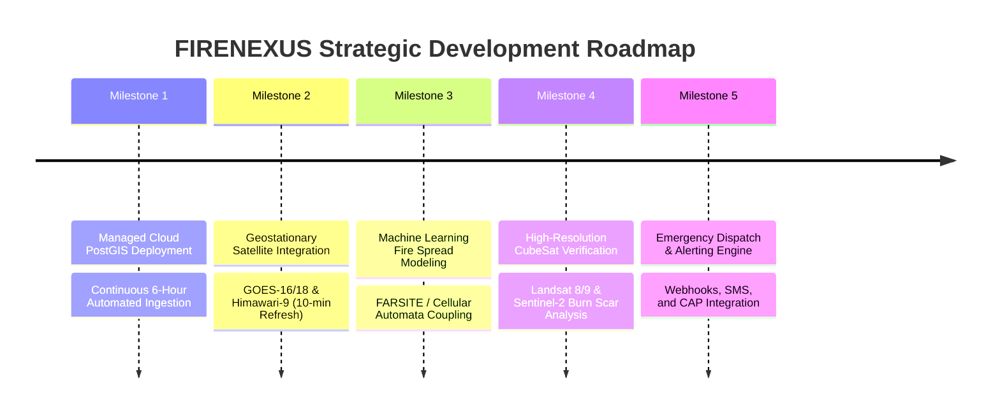

# FIRENEXUS: Scientific Limitations & Future Development Scope

**System**: FIRENEXUS Satellite Active Fire Monitoring & Harmonization Platform  
**Purpose**: Transparent Engineering Audit of Known Boundaries, Physical Constraints, and Strategic Roadmap  
**Standards Compliance**: NASA Open Science & Reproducible Research Guidelines  

---

## SECTION 1: SCIENTIFIC & ENGINEERING LIMITATIONS

True geospatial engineering requires absolute honesty regarding physical, mathematical, and infrastructural boundaries. FIRENEXUS explicitly identifies the following operational and scientific limitations:

### 1.1 Database Staging Provisioning Status (Honest Reporting)
- **Status**: **`[POSTGRES_VERIFICATION_PENDING]`**
- **Technical Context**: All 14 relational schemas, spatial geometry models (`PostGISPoint`), and Alembic migrations (`001_initial_schema.py`) are fully implemented and verified via automated testing. However, on the local host workstation used for development:
  - Docker Desktop is not installed, preventing local containerized PostGIS deployment.
  - Native Windows port 5432 is offline (no running local PostgreSQL daemon).
- **Compliance Policy**: In strict adherence to scientific integrity rules, SQLite test results were never substituted or represented as "live PostgreSQL/PostGIS verification." Live database activation is queued for cloud staging deployment (e.g. Neon or Supabase managed PostgreSQL with native PostGIS).

### 1.2 Heuristic Nature of the Algorithmic Match Score
- **Limitation**: The cross-sensor match score ($\text{score} = 0.60 \cdot s_{\text{spatial}} + 0.40 \cdot s_{\text{temporal}}$) is an **empirical correspondence heuristic**, not a mathematically calibrated Bayesian probability or ground-truth verification.
- **Scientific Implication**: A match score of $0.85$ indicates strong geometric overlap and orbital proximity, but does not prove that both instruments sampled the exact same flame front. In complex wildfire complexes with rapid crowning or extreme rate-of-spread, a fire may move or split within the 15–45 minute overpass separation.

### 1.3 Physical Sensor Non-Equivalence
- **Optical Differences**: MODIS and VIIRS observe thermal radiant energy with completely different optical systems, instantaneous fields of view (IFOV), point spread functions (PSF), and spectral bandpass filters.
- **Footprint Non-Equivalence**: A 1,000 m MODIS pixel and a 375 m VIIRS pixel can never be physically identical. A MODIS pixel measures the spatially integrated thermal radiance of a $1.0\text{ km}^2$ ground footprint, including unburned vegetation, tree canopies, and background soil, whereas a 375 m VIIRS pixel isolates flaming fronts with significantly less sub-pixel background dilution.

### 1.4 Cloud Cover, Smoke Plume & Canopy Obscuration
- **Physical Barrier**: Optical mid-infrared (3.9 µm) and thermal infrared (11 µm) remote sensing cannot penetrate dense meteorological clouds (e.g. stratus, cumulonimbus) or heavy, water-vapor-saturated pyrocumulonimbus (pyroCb) smoke plumes.
- **Canopy Attenuation**: In dense closed-canopy rainforests (such as the Amazon or Congo basins), understory surface fires burning below dense canopy foliage emit radiant heat that is partially absorbed and scattered by tree crowns, resulting in severe FRP underestimation or complete detection omission until the fire crowns.

### 1.5 Radiometric Channel Saturation Discrepancy
- **VIIRS I-Band Saturation**: Band I4 (375 m) saturates at approximately **~367 Kelvin**. Over intense wildfire fronts, the 375 m channel radiance saturates, forcing upstream algorithms to substitute radiance from the coarser 750 m M13 band or mark the pixel as saturated.
- **MODIS Dynamic Range**: MODIS Band 21 is a dedicated low-gain channel that remains linear up to **500 Kelvin**. Consequently, under catastrophic wildfire conditions, MODIS maintains radiometric linearity where VIIRS I-band may saturate.

### 1.6 Omission of Small Low-Intensity Wildfires
- **Detection Floor**: VIIRS can detect active fires releasing as little as **~0.5 to 1.0 MW** of radiant heat. MODIS typically requires **~8.0 to 11.0 MW** to trigger an active fire detection.
- **Harmonization Implication**: Thousands of small, early-ignition, or smoldering agricultural fires detected by VIIRS will **never have a co-located MODIS counterpart**. Any algorithm attempting to find 1:1 pairs across the entire catalog will observe that a majority of VIIRS hotspots are unpaired.

### 1.7 Non-Equivalence of Satellite Confidence Metrics
- **MODIS Confidence**: A continuous integer percentage (`0% to 100%`) based on multiple radiometric and atmospheric tests.
- **VIIRS Confidence**: A discrete three-tier categorical flag (`low`, `nominal`, `high`).
- **Harmonization Compromise**: FIRENEXUS maps MODIS percentages into categorical bins ($<30\%$ low, $30\%–80\%$ nominal, $>80\%$ high). While scientifically practical, this transformation reduces continuous variance.

### 1.8 Risk of Transitive Chaining in Spatial Clustering
- **Graph Clustering Phenomenon**: In graph-based connected-component clustering, hotspots can form continuous linear chains over large geographic distances.
- **Implemented Mitigation**: In `fire_event_service.py`, FIRENEXUS mitigates runaway chaining by enforcing a maximum cluster diameter constraint: no observation in a cluster may exceed **15.0 km** from the seed hotspot, splitting sprawling fire complexes into distinct clusters.

### 1.9 Limitations of Mean Absolute Percentage Error (MAPE)
- **Low-FRP Distortion**: In `FRPAnalysisService`, when two matched observations observe a low-energy fire (e.g. MODIS = 2.0 MW, VIIRS = 4.0 MW), the absolute difference is only 2.0 MW, but the percentage error is $100\%$. In datasets with many low-energy fires, MAPE is distorted upwards. We mitigate this by bounding the denominator ($\max(1.0, x_i)$) and pairing MAPE with Mean Absolute Error (MAE) and Root Mean Square Error (RMSE).

---

## SECTION 2: FUTURE DEVELOPMENT ROADMAP

FIRENEXUS is architected to evolve from a competition-winning prototype into an operational planetary intelligence platform. The planned engineering roadmap encompasses five strategic milestones:

### Milestone 1: Managed Cloud Database & Continuous Automated Pipeline
- **Target**: Immediate Post-Hackathon Phase.
- **Technical Scope**:
  - Provision serverless PostgreSQL 16 on **Neon** or **Supabase** with native PostGIS.
  - Execute `flask db upgrade` to establish the 14 schemas in production.
  - Transition the scheduled background script (`backend/scripts/run_background_pipeline.py`) to a standalone cloud worker (Celery Beat / AWS EventBridge) running automated 6-hour ingestion cycles.
  - Zero-maintenance staging deployment on Vercel/Cloudflare Pages (frontend) and Railway/Render (API service).

### Milestone 2: Geostationary Satellite Ingestion (GOES & Himawari)
- **Target**: Q1 2027.
- **Scientific Need**: Polar satellites (MODIS and VIIRS) only sample a given point on Earth 2 to 4 times per day. Wildfires can explode in size within 30 minutes.
- **Technical Scope**:
  - Integrate NASA/NOAA **GOES-16 and GOES-18 ABI** active fire products (covering the Americas at 2 km resolution every 5–10 minutes).
  - Integrate JMA **Himawari-9** (covering Asia-Pacific).
  - Use geostationary observations to interpolate fire radiative energy between polar overpasses, achieving continuous 24-hour diurnal monitoring.

### Milestone 3: Machine Learning Fire Spread & Smoke Plume Modeling
- **Target**: Q2 2027.
- **Technical Scope**:
  - Ingest NOAA High-Resolution Rapid Refresh (HRRR) real-time wind vectors, humidity, and terrain slope.
  - Train a physics-informed neural network (PINN) or cellular automata model using harmonized Fire Events to forecast fire front propagation 6, 12, and 24 hours into the future.
  - Compute convective smoke plume injection height based on aggregate cluster FRP and boundary layer thermodynamic soundings.

### Milestone 4: Multi-Scale Verification with Landsat & Sentinel-2
- **Target**: Q3 2027.
- **Scientific Need**: Validate empirical calibration models against independent, ultra-high-resolution sensors.
- **Technical Scope**:
  - Ingest **Landsat 8/9 OLI** (30 m active fire and post-fire NBR burn scars) and **Copernicus Sentinel-2 MSI** (20 m shortwave infrared fire detections).
  - Cross-reference harmonized MODIS/VIIRS fire events against Sentinel-2 20-meter perimeter contours to calculate true sub-pixel detection accuracy and commission/omission error matrices.

### Milestone 5: Incident Management & Automated Public Alerting Engine
- **Target**: Q4 2027.
- **Operational Scope**:
  - Develop an automated alert microservice adhering to the OASIS Common Alerting Protocol (**CAP**).
  - Dispatch real-time webhooks, SMS alerts, and email notifications to local fire protection districts when an active fire cluster exceeds critical FRP thresholds or approaches wildland-urban interface (WUI) zones.
  - Export harmonized fire perimeters directly to Esri ArcGIS Online, Google Earth Engine, and QGIS via standard OGC WMS/WFS services.
